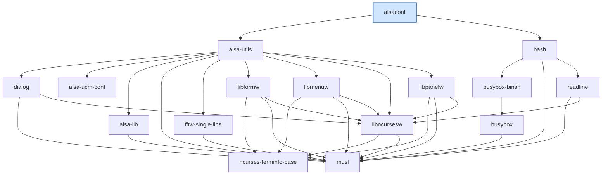
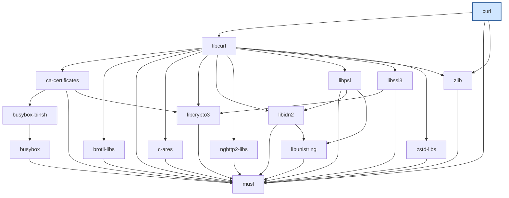
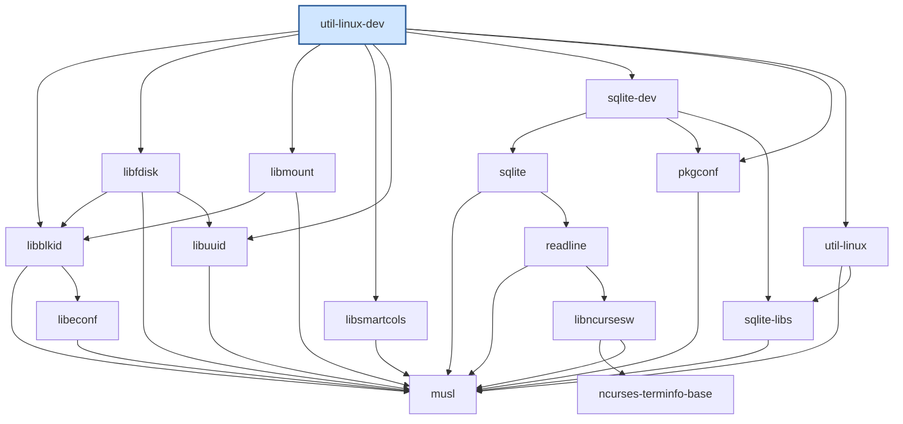

# Примеры использования этапов 3-5

Полные примеры к [README](../README.md): вывод команд `stage3`, `stage4`
и `stage5` на тестовом репозитории (`examples/test_repo.txt`) и на
реальных пакетах Alpine v3.20. Вывод получен запуском команд из корня
проекта.

## Этап 3: примеры с тестовым репозиторием

Все примеры используют `examples/test_repo.txt`; различаются только
`package_name` и `filter_substring` в конфигурации. Вывод ниже получен
запуском команд.

**Ромб** (`config_test_mode.yaml`, корень `A`): общая зависимость `D` встречается в графе один раз.

```
$ python -m depgraph stage3 -c examples/config_test_mode.yaml
Пакет: A
Граф зависимостей (порядок BFS, [уровень]):
  A [0] -> B, C
  B [1] -> D
  C [1] -> D
  D [2] -> (нет зависимостей)
Транзитивные зависимости (3): B, C, D
Циклические зависимости: нет
```

**Цикл** (`config_test_cycle.yaml`, корень `E`): обход завершается, цикл выведен.

```
$ python -m depgraph stage3 -c examples/config_test_cycle.yaml
Пакет: E
Граф зависимостей (порядок BFS, [уровень]):
  E [0] -> F
  F [1] -> G
  G [2] -> E, H
  H [3] -> (нет зависимостей)
Транзитивные зависимости (3): F, G, H
Циклические зависимости (1):
  E -> F -> G -> E
```

**Зависимость от самого себя** (`config_test_self_loop.yaml`, корень `I`):

```
$ python -m depgraph stage3 -c examples/config_test_self_loop.yaml
Пакет: I
Граф зависимостей (порядок BFS, [уровень]):
  I [0] -> I, J
  J [1] -> (нет зависимостей)
Транзитивные зависимости (1): J
Циклические зависимости (1):
  I -> I
```

**Фильтр** (`config_test_filter.yaml`, корень `K`): подстрока `B`: пакеты `KB` и `BK` исключены, `L` остаётся.

```
$ python -m depgraph stage3 -c examples/config_test_filter.yaml
Пакет: K
Граф зависимостей (порядок BFS, [уровень]):
  K [0] -> L
  L [1] -> (нет зависимостей)
Транзитивные зависимости (1): L
Циклические зависимости: нет
Исключено фильтром 'B': BK, KB
```

**Пакет не описан в файле** (`config_test_unresolved.yaml`, корень `M`):

```
$ python -m depgraph stage3 -c examples/config_test_unresolved.yaml
Пакет: M
Граф зависимостей (порядок BFS, [уровень]):
  M [0] -> N, Z
  N [1] -> (нет зависимостей)
  Z [1] -> (нет зависимостей)
Транзитивные зависимости (2): N, Z
Циклические зависимости: нет
Не найдены в репозитории (1): N
```

**Пакет без зависимостей** (`config_test_leaf.yaml`, корень `Y`):

```
$ python -m depgraph stage3 -c examples/config_test_leaf.yaml
Пакет: Y
Граф зависимостей (порядок BFS, [уровень]):
  Y [0] -> (нет зависимостей)
Транзитивные зависимости (0): нет
Циклические зависимости: нет
```

Ошибки тестового режима (код 3):

```
Ошибка получения данных: пакет 'Q' не найден в репозитории
Ошибка получения данных: корневой пакет 'KB' содержит подстроку фильтра 'B' и исключён из анализа
Ошибка получения данных: файл 'repo.txt': строка 2: ожидается 'ИМЯ: зависимости', получено 'неверно'
```

## Этап 3: примеры на реальных пакетах Alpine

Репозиторий Alpine v3.20 (`main`, `x86_64`), три пакета с глубиной графа
3, 4 и 5 уровней; в каждом графе по 15 транзитивных зависимостей, циклов
нет. Вывод получен на полном реальном индексе (интернет нужен только для
запуска; тесты используют сохранённую выгрузку 41 записи,
`tests/data/alpine_v3.20_main_subset.txt`, и сверяют вывод с этим
эталоном).

Обратите внимание: зависимости в индексе записаны виртуальными именами
(`so:libc.musl-x86_64.so.1`, `/bin/sh`), а в графе они показаны пакетами
(`musl`, `busybox-binsh`). Версия в индексе может измениться - если
версии нет, программа выведет список доступных.

**alsaconf** (глубина 3, `config_real_alsaconf.yaml`):

```
$ python -m depgraph stage3 -c examples/config_real_alsaconf.yaml
Пакет: alsaconf
Граф зависимостей (порядок BFS, [уровень]):
  alsaconf [0] -> alsa-utils, bash
  alsa-utils [1] -> dialog, alsa-ucm-conf, alsa-lib, musl, fftw-single-libs, libformw, libmenuw, libncursesw, libpanelw
  bash [1] -> busybox-binsh, musl, readline
  dialog [2] -> musl, libncursesw
  alsa-ucm-conf [2] -> (нет зависимостей)
  alsa-lib [2] -> musl
  musl [2] -> (нет зависимостей)
  fftw-single-libs [2] -> musl
  libformw [2] -> ncurses-terminfo-base, musl, libncursesw
  libmenuw [2] -> ncurses-terminfo-base, musl, libncursesw
  libncursesw [2] -> ncurses-terminfo-base, musl
  libpanelw [2] -> ncurses-terminfo-base, musl, libncursesw
  busybox-binsh [2] -> busybox
  readline [2] -> musl, libncursesw
  ncurses-terminfo-base [3] -> (нет зависимостей)
  busybox [3] -> musl
Транзитивные зависимости (15): alsa-utils, bash, dialog, alsa-ucm-conf, alsa-lib, musl, fftw-single-libs, libformw, libmenuw, libncursesw, libpanelw, busybox-binsh, readline, ncurses-terminfo-base, busybox
Циклические зависимости: нет

```

**curl** (глубина 4, `config_real_curl.yaml`):

```
$ python -m depgraph stage3 -c examples/config_real_curl.yaml
Пакет: curl
Граф зависимостей (порядок BFS, [уровень]):
  curl [0] -> libcurl, musl, zlib
  libcurl [1] -> ca-certificates, brotli-libs, musl, c-ares, libcrypto3, libidn2, nghttp2-libs, libpsl, libssl3, zlib, zstd-libs
  musl [1] -> (нет зависимостей)
  zlib [1] -> musl
  ca-certificates [2] -> busybox-binsh, musl, libcrypto3
  brotli-libs [2] -> musl
  c-ares [2] -> musl
  libcrypto3 [2] -> musl
  libidn2 [2] -> musl, libunistring
  nghttp2-libs [2] -> musl
  libpsl [2] -> musl, libidn2, libunistring
  libssl3 [2] -> libcrypto3, musl
  zstd-libs [2] -> musl
  busybox-binsh [3] -> busybox
  libunistring [3] -> musl
  busybox [4] -> musl
Транзитивные зависимости (15): libcurl, musl, zlib, ca-certificates, brotli-libs, c-ares, libcrypto3, libidn2, nghttp2-libs, libpsl, libssl3, zstd-libs, busybox-binsh, libunistring, busybox
Циклические зависимости: нет

```

**util-linux-dev** (глубина 5, `config_real_util_linux_dev.yaml`):

```
$ python -m depgraph stage3 -c examples/config_real_util_linux_dev.yaml
Пакет: util-linux-dev
Граф зависимостей (порядок BFS, [уровень]):
  util-linux-dev [0] -> libblkid, libfdisk, libmount, libsmartcols, libuuid, sqlite-dev, pkgconf, util-linux
  libblkid [1] -> musl, libeconf
  libfdisk [1] -> libblkid, musl, libuuid
  libmount [1] -> libblkid, musl
  libsmartcols [1] -> musl
  libuuid [1] -> musl
  sqlite-dev [1] -> sqlite, pkgconf, sqlite-libs
  pkgconf [1] -> musl
  util-linux [1] -> musl, sqlite-libs
  musl [2] -> (нет зависимостей)
  libeconf [2] -> musl
  sqlite [2] -> musl, readline
  sqlite-libs [2] -> musl
  readline [3] -> musl, libncursesw
  libncursesw [4] -> ncurses-terminfo-base, musl
  ncurses-terminfo-base [5] -> (нет зависимостей)
Транзитивные зависимости (15): libblkid, libfdisk, libmount, libsmartcols, libuuid, sqlite-dev, pkgconf, util-linux, musl, libeconf, sqlite, sqlite-libs, readline, libncursesw, ncurses-terminfo-base
Циклические зависимости: нет
```

## Этап 4: примеры с тестовым репозиторием

Все примеры используют `examples/test_repo.txt`; различаются
`package_name` и `filter_substring` в конфигурации. Вывод получен
запуском команд.

**Ромб** (`config_reverse_diamond.yaml`, пакет `D`): у `D` напрямую зависят `B` и `C`, а `A` зависит от него через оба пути и выводится один раз.

```
$ python -m depgraph stage4 -c examples/config_reverse_diamond.yaml
Пакет: D
Обратные зависимости (порядок BFS, [уровень], '<-' ведёт к зависящим пакетам):
  D [0] <- B, C
  B [1] <- A
  C [1] <- A
  A [2] <- (никто не зависит)
Пакеты, зависящие от D (3): B, C, A
Циклические зависимости: нет
```

**Цикл** (`config_reverse_cycle.yaml`, пакет `E`): `E` лежит на цикле `E -> F -> G -> E`: зависящие пакеты `G`, `F`, цикл выведен, обход завершается.

```
$ python -m depgraph stage4 -c examples/config_reverse_cycle.yaml
Пакет: E
Обратные зависимости (порядок BFS, [уровень], '<-' ведёт к зависящим пакетам):
  E [0] <- G
  G [1] <- F
  F [2] <- E
Пакеты, зависящие от E (2): G, F
Циклические зависимости (1):
  E <- G <- F <- E
```

**Зависимость от самого себя** (`config_reverse_self_loop.yaml`, пакет `J`): `I` зависит от `J` и от самого себя.

```
$ python -m depgraph stage4 -c examples/config_reverse_self_loop.yaml
Пакет: J
Обратные зависимости (порядок BFS, [уровень], '<-' ведёт к зависящим пакетам):
  J [0] <- I
  I [1] <- I
Пакеты, зависящие от J (1): I
Циклические зависимости (1):
  I <- I
```

**Фильтр** (`config_reverse_filter.yaml`, пакет `L`): подстрока `B`: `KB` и `BK` зависят от `L`, но исключены; `K` зависит от `L` напрямую и остаётся.

```
$ python -m depgraph stage4 -c examples/config_reverse_filter.yaml
Пакет: L
Обратные зависимости (порядок BFS, [уровень], '<-' ведёт к зависящим пакетам):
  L [0] <- K
  K [1] <- (никто не зависит)
Пакеты, зависящие от L (1): K
Циклические зависимости: нет
Исключено фильтром 'B': BK, KB
```

**Пакет не описан в файле** (`config_reverse_unresolved.yaml`, пакет `N`): `N` только упомянут как зависимость `M`.

```
$ python -m depgraph stage4 -c examples/config_reverse_unresolved.yaml
Пакет: N
Обратные зависимости (порядок BFS, [уровень], '<-' ведёт к зависящим пакетам):
  N [0] <- M
  M [1] <- (никто не зависит)
Пакеты, зависящие от N (1): M
Циклические зависимости: нет
```

**Цепочка** (`config_reverse_chain.yaml`, пакет `S`): зависящие пакеты на трёх уровнях.

```
$ python -m depgraph stage4 -c examples/config_reverse_chain.yaml
Пакет: S
Обратные зависимости (порядок BFS, [уровень], '<-' ведёт к зависящим пакетам):
  S [0] <- R
  R [1] <- Q
  Q [2] <- P
  P [3] <- (никто не зависит)
Пакеты, зависящие от S (3): R, Q, P
Циклические зависимости: нет
```

**Никто не зависит** (`config_reverse_none.yaml`, пакет `A`): от `A` не зависит ни один пакет.

```
$ python -m depgraph stage4 -c examples/config_reverse_none.yaml
Пакет: A
Обратные зависимости (порядок BFS, [уровень], '<-' ведёт к зависящим пакетам):
  A [0] <- (никто не зависит)
Пакеты, зависящие от A (0): нет
Циклические зависимости: нет
```

Ошибки (код 3):

```
Ошибка получения данных: пакет 'Q' не найден в репозитории
Ошибка получения данных: корневой пакет 'KB' содержит подстроку фильтра 'B' и исключён из анализа
```

## Этап 5: примеры с тестовым репозиторием

Конфигурации `examples/config_viz_*.yaml` используют
`examples/test_repo.txt`. Вывод получен запуском команд.

**Ромб** (`config_viz_diamond.yaml`, пакет `A`): общая зависимость `D` нарисована под каждым родителем (лист, поэтому без пометки).

```
$ python -m depgraph stage5 -c examples/config_viz_diamond.yaml
graph TD
    A --> B
    A --> C
    B --> D
    C --> D
    classDef root fill:#d0e6ff,stroke:#2b5c99,stroke-width:2px
    class A root

ASCII-дерево зависимостей:
A
|-- B
|   `-- D
`-- C
    `-- D
```

**Цикл** (`config_viz_cycle.yaml`, пакет `E`): цикл `E -> F -> G -> E` виден в диаграмме рёбрами, в дереве - пометкой `(цикл)`.

```
$ python -m depgraph stage5 -c examples/config_viz_cycle.yaml
graph TD
    E --> F
    F --> G
    G --> E
    G --> H
    classDef root fill:#d0e6ff,stroke:#2b5c99,stroke-width:2px
    class E root

ASCII-дерево зависимостей:
E
`-- F
    `-- G
        |-- E (цикл)
        `-- H
(цикл) - пакет уже есть среди его предков
```

**Пакет не описан в файле** (`config_viz_unresolved.yaml`, пакет `M`): `ascii_tree: false`, поэтому только Mermaid; `N` нарисован пунктиром (класс `missing`).

```
$ python -m depgraph stage5 -c examples/config_viz_unresolved.yaml
graph TD
    M --> N
    M --> Z
    classDef root fill:#d0e6ff,stroke:#2b5c99,stroke-width:2px
    class M root
    classDef missing stroke-dasharray:5 5
    class N missing
```

**Общая зависимость** (`config_viz_shared.yaml`, пакет `T`): `W` нужен и `U`, и `V`: в дереве он раскрыт один раз, повтор помечен `(*)`.

```
$ python -m depgraph stage5 -c examples/config_viz_shared.yaml
graph TD
    T --> U
    T --> V
    U --> W
    V --> W
    W --> X
    classDef root fill:#d0e6ff,stroke:#2b5c99,stroke-width:2px
    class T root

ASCII-дерево зависимостей:
T
|-- U
|   `-- W
|       `-- X
`-- V
    `-- W (*)
(*) - зависимости этого пакета показаны выше
```

## Этап 5: примеры на реальных пакетах Alpine

Три разных пакета Alpine v3.20 (`main`, `x86_64`) с глубиной графа 3, 4 и
5 уровней: `alsaconf`, `curl`, `util-linux-dev` (конфигурации
`examples/config_real_*.yaml`, `ascii_tree: true`). Граф совпадает с
графом этапа 3, построенным на полном реальном индексе; для
воспроизводимости ниже показан вывод на сохранённой выгрузке
`tests/data/alpine_v3.20_main_subset.txt`. Диаграммы вставлены в виде
блоков ```` ```mermaid ````, GitHub рисует их как схемы.

### alsaconf (глубина 3)



Команда: `python -m depgraph stage5 -c examples/config_real_alsaconf.yaml`

Текст диаграммы Mermaid выводится на экран как есть (см. блок выше, он
совпадает с выводом). ASCII-дерево из того же запуска:

```
alsaconf
|-- alsa-utils
|   |-- dialog
|   |   |-- musl
|   |   `-- libncursesw
|   |       |-- ncurses-terminfo-base
|   |       `-- musl
|   |-- alsa-ucm-conf
|   |-- alsa-lib
|   |   `-- musl
|   |-- musl
|   |-- fftw-single-libs
|   |   `-- musl
|   |-- libformw
|   |   |-- ncurses-terminfo-base
|   |   |-- musl
|   |   `-- libncursesw (*)
|   |-- libmenuw
|   |   |-- ncurses-terminfo-base
|   |   |-- musl
|   |   `-- libncursesw (*)
|   |-- libncursesw (*)
|   `-- libpanelw
|       |-- ncurses-terminfo-base
|       |-- musl
|       `-- libncursesw (*)
`-- bash
    |-- busybox-binsh
    |   `-- busybox
    |       `-- musl
    |-- musl
    `-- readline
        |-- musl
        `-- libncursesw (*)
(*) - зависимости этого пакета показаны выше
```

### curl (глубина 4)



Команда: `python -m depgraph stage5 -c examples/config_real_curl.yaml`

Текст диаграммы Mermaid выводится на экран как есть (см. блок выше, он
совпадает с выводом). ASCII-дерево из того же запуска:

```
curl
|-- libcurl
|   |-- ca-certificates
|   |   |-- busybox-binsh
|   |   |   `-- busybox
|   |   |       `-- musl
|   |   |-- musl
|   |   `-- libcrypto3
|   |       `-- musl
|   |-- brotli-libs
|   |   `-- musl
|   |-- musl
|   |-- c-ares
|   |   `-- musl
|   |-- libcrypto3 (*)
|   |-- libidn2
|   |   |-- musl
|   |   `-- libunistring
|   |       `-- musl
|   |-- nghttp2-libs
|   |   `-- musl
|   |-- libpsl
|   |   |-- musl
|   |   |-- libidn2 (*)
|   |   `-- libunistring (*)
|   |-- libssl3
|   |   |-- libcrypto3 (*)
|   |   `-- musl
|   |-- zlib
|   |   `-- musl
|   `-- zstd-libs
|       `-- musl
|-- musl
`-- zlib (*)
(*) - зависимости этого пакета показаны выше
```

### util-linux-dev (глубина 5)



Команда: `python -m depgraph stage5 -c examples/config_real_util_linux_dev.yaml`

Текст диаграммы Mermaid выводится на экран как есть (см. блок выше, он
совпадает с выводом). ASCII-дерево из того же запуска:

```
util-linux-dev
|-- libblkid
|   |-- musl
|   `-- libeconf
|       `-- musl
|-- libfdisk
|   |-- libblkid (*)
|   |-- musl
|   `-- libuuid
|       `-- musl
|-- libmount
|   |-- libblkid (*)
|   `-- musl
|-- libsmartcols
|   `-- musl
|-- libuuid (*)
|-- sqlite-dev
|   |-- sqlite
|   |   |-- musl
|   |   `-- readline
|   |       |-- musl
|   |       `-- libncursesw
|   |           |-- ncurses-terminfo-base
|   |           `-- musl
|   |-- pkgconf
|   |   `-- musl
|   `-- sqlite-libs
|       `-- musl
|-- pkgconf (*)
`-- util-linux
    |-- musl
    `-- sqlite-libs (*)
(*) - зависимости этого пакета показаны выше
```
